# Project Documentation

## Project Overview

The DNIHS Assessment Consolidation and Analytics System is a web application built with Laravel (PHP 8.3), React 19, Tailwind CSS, and PostgreSQL for recording, computing, and consolidating periodic exam and diagnostic test scores for Grades 7 to 10 at Dayap National Integrated High School. Teachers log in to encode raw student scores and least learned competencies for their assigned classes, and the system automatically computes the class Mean, Standard Deviation, Mean Percentage Score (MPS), and DepEd Mastery Level. On the admin side, the system manages school years, terms, sections, teacher accounts, and class loads, and automatically combines all submitted class records into a single consolidated performance report. It solves the issues of using shared spreadsheets (such as accidental score overwrites, broken formulas, and slow manual consolidation), making score recording faster for teachers and giving school administrators a clear view of student performance across all grade levels and subjects.

---

## Screens

### Front-End Overview
The front-end is a Single Page Application (SPA) built with React 19, Vite, Tailwind CSS v4, Lucide React icons, and Motion for page transitions. On desktop screens, the layout uses a collapsible left sidebar, a top header bar showing the logged-in user, and full-width tables for reports and class management. On mobile screens, the sidebar turns into a slide-out menu drawer and tables scroll horizontally so forms and reports remain easy to use on phones.

### Screen Descriptions

#### 1. Login
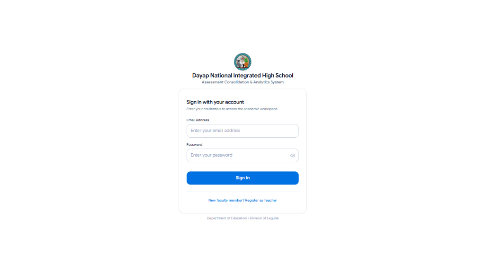

Shows the DNIHS login card where teachers and administrators enter their email address and password to access the system. It includes a show/hide password button and a link at the bottom for new teachers who need to register an account.

#### 2. Create Faculty Account
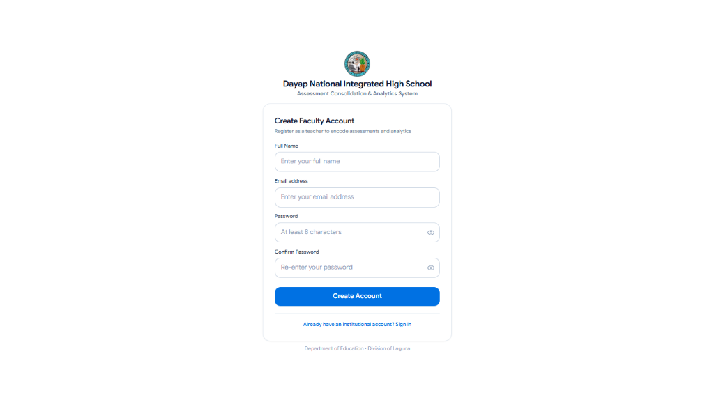

Allows new faculty members to register by entering their full name, email address, password, and password confirmation. Newly created teacher accounts are saved with a pending status until the System Administrator approves them.

#### 3. Consolidated Reports
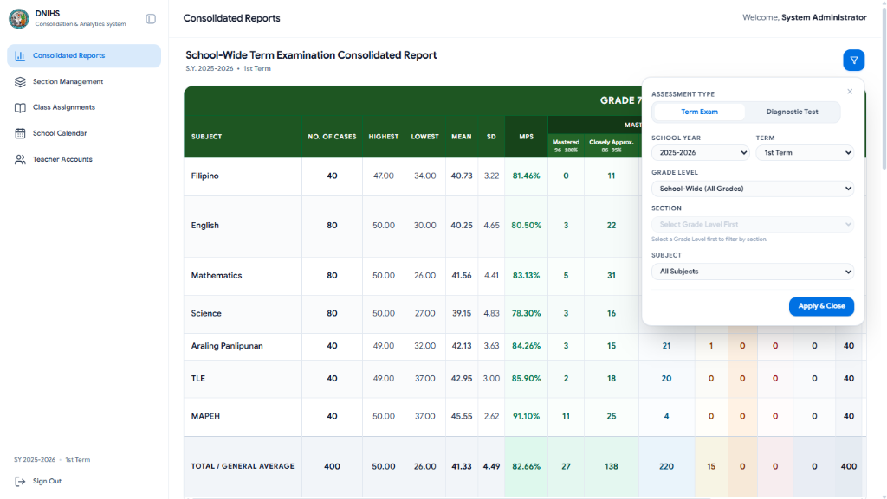

Displays the consolidated examination report table for the school, showing the number of cases, highest and lowest scores, mean, standard deviation, MPS, and the number of students under each of the 7 DepEd Mastery brackets per subject. Administrators can click the filter button on the upper right to filter results by assessment type (Term Exam or Diagnostic Test), school year, term, grade level, section, and subject.

#### 4. Section Management
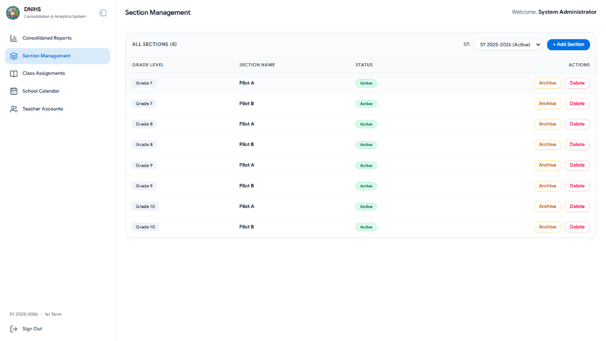

Lists all classroom sections for the selected school year along with their grade level and status. From this screen, the administrator can add new sections, archive existing ones, or delete sections that do not have encoded assessment records yet.

#### 5. Class Assignments
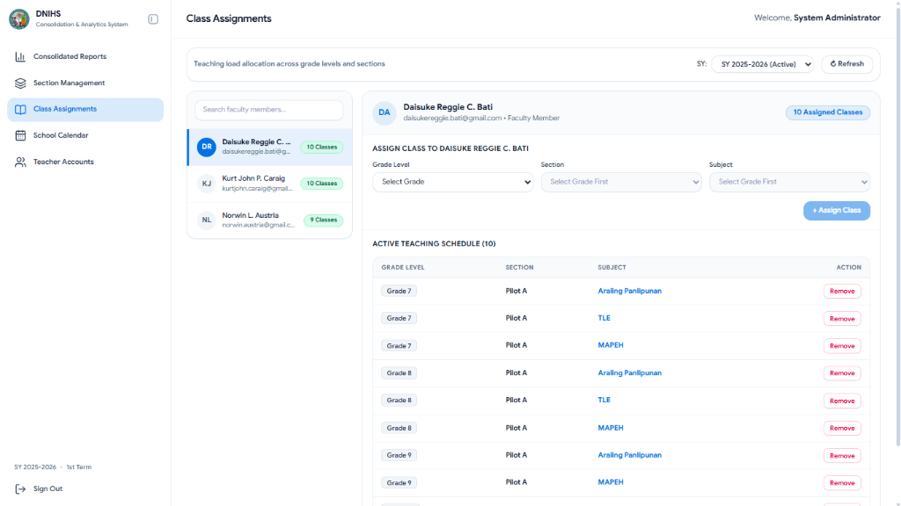

Lets the administrator assign teaching loads to faculty members. Selecting a teacher from the list on the left displays their current schedule on the right, where the administrator can assign a new grade level, section, and subject or remove an existing class load.

#### 6. School Calendar
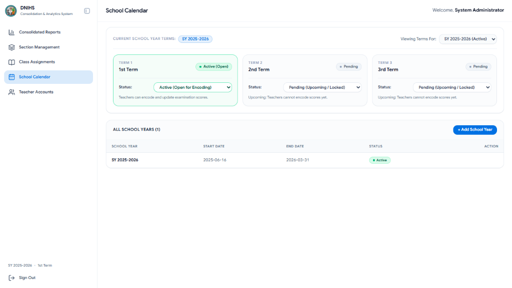

Used by the administrator to manage school years and control when teachers can encode scores. The top panel shows the three terms of the selected school year and lets the admin set each term to Active (open for encoding) or Pending/Completed (locked), while the bottom table lists all school years and lets the admin add a new school year.

#### 7. Teacher Accounts
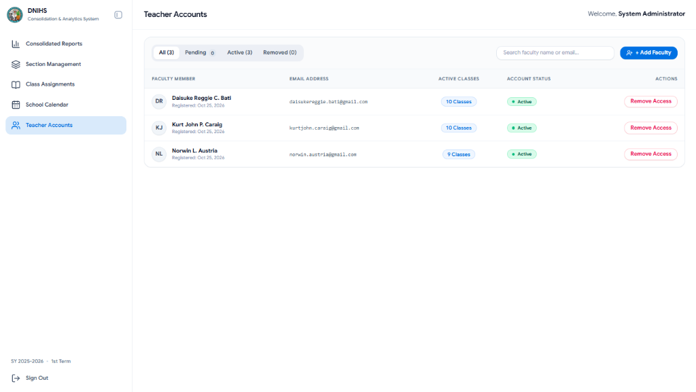

Shows all registered faculty accounts with filters for All, Pending, Active, and Removed accounts. Administrators can search for teachers, add a new faculty account directly, approve or reject pending registrations, or remove a teacher's access without deleting their past class records.

#### 8. Teacher Record Entry
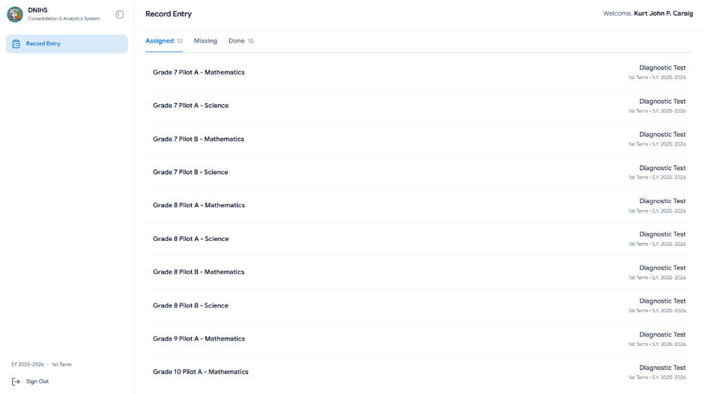

The main screen for logged-in teachers. It lists all classes assigned to the teacher for the current school year and term, grouped under Assigned, Missing, and Done tabs so teachers can easily track which class exams still need to be encoded.

#### 9. Teacher Student Score Encoding - New Entry
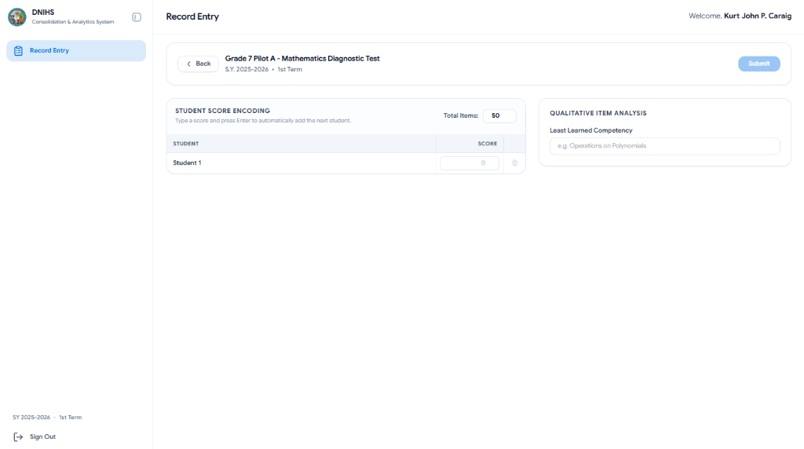

Opens when a teacher selects a class that has no encoded scores yet. Teachers set the total number of test items, type each student's raw score into the table, enter the least learned competency on the right panel, and click Submit to save the record and automatically compute the class statistics.

#### 10. Teacher Student Score Encoding - Update / Delete
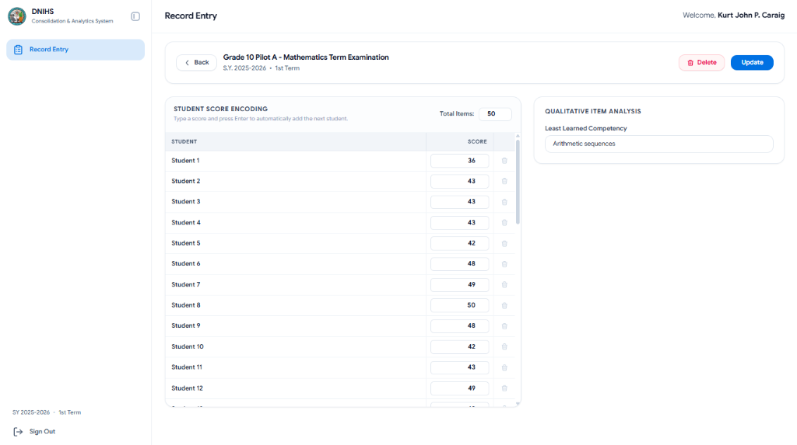

Opens when a teacher selects a class that already has saved scores. While the term is still open, the teacher can edit student scores, update the least learned competency, and click Update to recompute the results, or click Delete to remove the submission.

---

## Project Structure

The project is structured as a Laravel REST API backend (PHP 8.3) connected to a React 19 frontend and a PostgreSQL database.

```text
m_capstone/
├── app/
│   ├── Console/Commands/
│   │   ├── DatabaseBackupCommand.php               # CLI command to back up the PostgreSQL database
│   │   └── DatabaseRestoreCommand.php              # CLI command to restore and verify database backups
│   ├── Http/
│   │   ├── Controllers/Api/
│   │   │   ├── AcademicReferenceController.php     # Returns grade levels, subjects, and active school year
│   │   │   ├── AssessmentController.php            # Handles score encoding, updates, and consolidated reports
│   │   │   ├── AuthController.php                  # Handles login, registration, logout, and user session
│   │   │   ├── SchoolYearController.php            # Creates and updates school years and their 3 terms
│   │   │   ├── SectionController.php               # Creates, updates, archives, and deletes sections
│   │   │   ├── TeacherAssignmentController.php     # Assigns and removes teacher subject loads
│   │   │   ├── TeacherController.php               # Manages teacher account approval and deactivation
│   │   │   └── TermController.php                  # Updates term status (pending, active, completed)
│   │   ├── Middleware/
│   │   │   └── EnsureUserHasRole.php               # Checks if the logged-in user is system_admin or teacher
│   │   ├── Requests/                               # FormRequest classes for server-side input validation
│   │   └── Resources/                              # Formats model data into clean JSON responses
│   ├── Models/                                     # Eloquent models for the database tables
│   │   ├── AssessmentRecord.php
│   │   ├── GradeLevel.php
│   │   ├── Role.php
│   │   ├── SchoolYear.php
│   │   ├── Section.php
│   │   ├── Subject.php
│   │   ├── TeachingAssignment.php
│   │   ├── Term.php
│   │   └── User.php
│   └── Services/
│       └── StatsCalculatorService.php              # Computes Mean, SD, MPS, Mastery Level, and Pooled Variance
├── database/
│   ├── migrations/                                 # Database tables, foreign keys, indexes, and triggers
│   └── seeders/                                    # Initial roles, admin account, grades, and subjects
├── resources/
│   ├── css/app.css                                 # Tailwind CSS v4 stylesheet
│   └── js/
│       ├── api.js                                  # Helper for API requests with Sanctum Bearer tokens
│       ├── App.jsx                                 # Main React component handling login state and page tabs
│       ├── main.jsx                                # React entry point
│       ├── components/                             # Shared UI components (Sidebar, TopBar, ScoreSheet, Modal)
│       └── pages/                                  # Page views for Login, Admin modules, and Teacher encoding
└── routes/
    ├── api.php                                     # All backend API endpoints
    ├── console.php                                 # Scheduled daily backup command
    └── web.php                                     # Serves the React app
```

### Functions Made
- `StatsCalculatorService::calculate($rawScores, $totalItems)`: Takes the array of student scores and total items, then computes the number of examinees, mean, population standard deviation, MPS, highest/lowest score, and the DepEd mastery description.
- `StatsCalculatorService::consolidate($records)`: Combines assessment records across multiple sections or grade levels and computes the overall standard deviation using pooled population variance.
- `StatsCalculatorService::getMasteryLevel($mps)`: Returns the matching DepEd mastery level bracket for a given MPS value.
- `AssessmentController::store()`, `update()`, and `consolidation()`: Checks if the term is open and if the teacher is assigned to the class before saving scores, and queries filtered records for the admin's consolidated report.
- `AuthController::login()`, `register()`, and `logout()`: Validates user login credentials, checks if a teacher account is approved and active, creates new teacher registrations, and manages Sanctum tokens.
- `TeacherAssignmentController::syncTeacher()`: Updates a teacher's assigned classes for the school year inside a database transaction.
- `fn_calculate_assessment_metrics()` and `fn_audit_assessment_records()`: PostgreSQL trigger functions that validate the mean against total items, compute MPS and mastery remarks in the database, and log any score changes or deletions into `assessment_audit_logs`.

---

## Database Structure

| Table Name | Purpose |
| :--- | :--- |
| `users` | Stores admin and teacher accounts, hashed passwords, active status (`is_active`), approval status (`pending`, `approved`, `rejected`), and soft-delete timestamps. |
| `roles` | Stores the user roles (`system_admin` and `teacher`). |
| `role_user` | Pivot table that links `users` to their assigned `roles`. |
| `school_years` | Stores school years (such as `2025-2026`), start and end dates, and which school year is currently active. |
| `terms` | Stores the 3 terms (`1st Term`, `2nd Term`, `3rd Term`) under each school year and whether encoding is `pending`, `active`, or `completed`. |
| `grade_levels` | Reference table for `Grade 7`, `Grade 8`, `Grade 9`, and `Grade 10`. |
| `sections` | Stores class sections (such as `Pilot A` and `Pilot B`) under a specific grade level and school year. |
| `subjects` | Stores the DepEd subjects per grade level along with their subject codes. |
| `teaching_assignments` | Links a teacher (`user_id`) to a specific section and subject for a school year, including start and end dates (`effective_from`, `effective_until`). |
| `assessment_records` | Stores the encoded array of student `raw_scores` (JSONB), `total_items`, computed statistics (`no_of_entries`, `mean`, `mps`, `sd`, `highest_score`, `lowest_score`), `least_learned_competency`, and mastery `remarks`. |
| `assessment_audit_logs` | Stores a history of old and new statistical values whenever an assessment record is updated or deleted. |
| `personal_access_tokens` | Stores Laravel Sanctum authentication tokens for logged-in users. |

---

## ERD Diagram

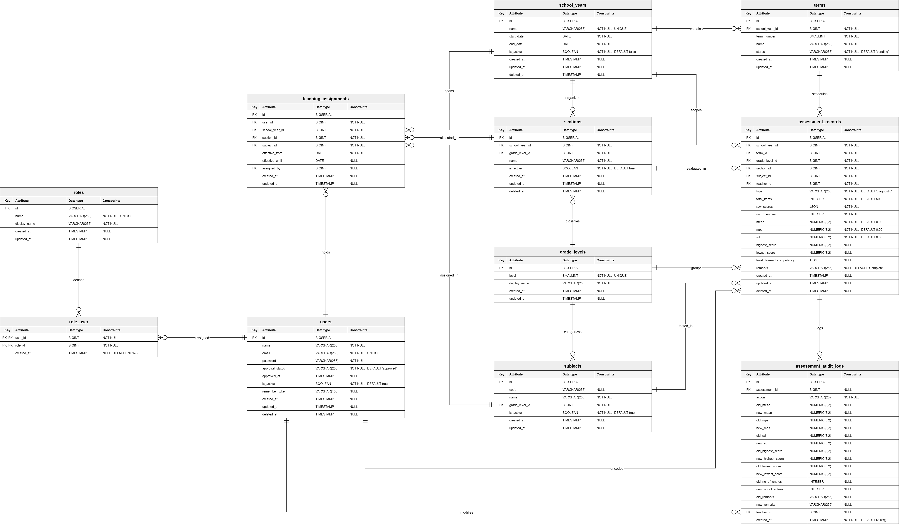

---

## Challenges and Solutions

### 1. Computing Consolidated Standard Deviation Across Multiple Sections
- **Problem**: In the old spreadsheet setup, the overall standard deviation for a grade level was computed by simply averaging the standard deviations of each section. During development, we found that this gives an inaccurate result when sections have different numbers of students or different class means.
- **Solution**: We updated `StatsCalculatorService::consolidate()` to use the pooled population variance formula:
  $$\sigma^2_{\text{pooled}} = \frac{1}{N} \sum_{i=1}^{k} n_i \left( \sigma_i^2 + (\mu_i - \bar{\mu})^2 \right), \quad \sigma_{\text{pooled}} = \sqrt{\sigma^2_{\text{pooled}}}$$
  This properly weights each section by its student count and accounts for differences between section means.

### 2. Reassigning Classes to Substitute Teachers Mid-Year
- **Problem**: Putting a normal unique constraint on `(school_year_id, section_id, subject_id)` in the `teaching_assignments` table prevented us from assigning a substitute teacher if the original teacher went on leave, unless we deleted the original teacher's assignment record.
- **Solution**: We used a PostgreSQL partial unique index (`WHERE effective_until IS NULL`). When a teacher leaves a class, we set their `effective_until` date instead of deleting the row. This allows a new teacher to be assigned to the same class while keeping the previous teacher's history intact.

### 3. Preventing Invalid Scores and Formula Errors
- **Problem**: In shared spreadsheets, teachers could accidentally type a score higher than the total number of test items or overwrite the cells containing the Mean, SD, and MPS formulas.
- **Solution**: We moved all calculations to the backend and database. The React score sheet blocks scores below `0` or above `total_items`, Laravel's `StoreAssessmentRequest` validates the submitted array on the server, and `StatsCalculatorService` along with a PostgreSQL trigger computes the Mean, SD, MPS, and Mastery Level automatically upon saving.
